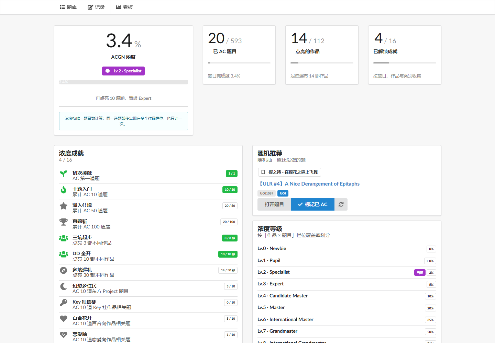
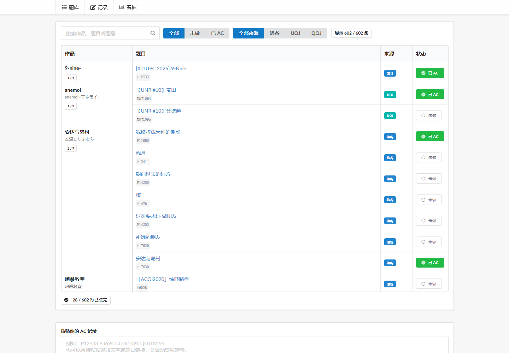

# 以 ACGN 为题目背景的题

把洛谷专栏 [《以 ACGN 为题目背景的题》](https://www.luogu.com.cn/article/93r0yhdc) 变成一个每天自动更新的静态站点：

- 每天定时抓取原文、解析两级 Markdown 列表、生成结构化数据；
- 用表格展示作品与题目，点击最右侧状态按钮即可标记 / 取消 AC；
- 同一道题 neta 了多部作品时，会在多个作品栏下同步打勾；
- 原文里重复出现的题目、加强版等**不会被合并**，按原样保留为多行；
- 做题记录保存在浏览器 `localStorage`，支持增量导入、备份、清空；
- 看板提供浓度、等级、成就、随机推荐、来源分布等；
- 前端使用 Vue 3 + Fomantic UI 默认组件风格。

数据更新与页面部署全部由 GitHub Actions 完成，页面托管在 GitHub Pages。





## 功能

### 题库表格

- 按原文顺序展示作品与题目；
- 只有最右侧的状态按钮可以切换 AC，点击表格其他位置不会改变状态；
- 搜索作品 / 题目 / 题号；
- 按「全部 / 未做 / 已 AC」和「洛谷 / UOJ / QOJ」筛选；
- 作品栏显示完成进度，点击作品名可快速筛选该作品；
- 多厨题会显示 `多厨 ×N` 徽章，并在每个栏位同步状态；
- 重复题目按行保留，每行显示自己的标题，不会错误合并。

### 增量导入

文本框只用于**增量添加**，不会覆盖已有记录：

```text
P12533 P3694 UOJ#1094 QOJ18255
https://www.luogu.com.cn/problem/P12533
https://uoj.ac/problem/1094
```

- 支持从整段文字、题号列表、题目链接中自动提取题号；
- 已经在记录里的题自动跳过；
- 题单中不存在的题号直接跳过，并在结果中列出；
- 导入成功后会清空文本框；
- 记录不会上传服务器。

### ACGN 浓度看板

- **浓度**：按唯一题目数计算。同一道题即使出现在多个作品栏位，也只计一次；
- **等级**：`Newbie → Pupil → Specialist → Expert → Candidate Master → Master → International Master → Grandmaster → International Grandmaster → Legendary Grandmaster → ACGN tourist`；
- **成就**：题目数量、作品数量、东方 / Key 系列、作品类别（百合、恋爱、奇幻、科幻、悬疑、Galgame）、全制霸；
- **随机推荐**：随机抽一道还没做的题，可换一题或直接标记 AC；
- **来源分布**：洛谷 / UOJ / QOJ 的完成情况。

看板**不做任何基于时间的统计**。用户通常一次性导入大量题目，导入时间不代表真实 AC 时间，因此没有「最近 AC」「连续打卡」「签到」「修仙模式」等功能。

所有成就（通用、系列、类别、全制霸）都定义在 [achievements.js](web/src/lib/achievements.js) 中，`stats.js` 只负责计算指标和进度。

## 本地运行

只需要 Node.js：

```bash
cd web
npm ci
npm run dev
```

生产构建：

```bash
cd web
npm ci
npm run build
npx vite preview
```

### 更新数据

需要 Python 3.10+，只使用标准库：

```bash
python scripts/update.py
```

它会访问洛谷，解析文章，写入：

- `data/article.md`：原文 Markdown 快照（仅供审阅，前端不读取）；
- `web/public/data/acgn.json`：前端数据。

离线解析本地 Markdown：

```bash
python scripts/update.py --from-file path/to/article.md --allow-shrink --output .tmp/acgn.json
```

### 测试

```bash
python -m unittest discover -s tests -v
cd web && npm test
```

## 项目结构

```text
.
├── .github/workflows/update-and-deploy.yml  # 定时抓取 + Pages 部署
├── data/article.md                          # 最近一次抓取的原文快照
├── scripts/
│   ├── fetch_article.py                     # 抓取 lentille-context 中的 Markdown
│   ├── acgn_parser.py                       # Markdown → 最小结构化数据
│   └── update.py                            # 抓取 + 解析 + 写文件
├── tests/                                   # Python 单元测试
└── web/
    ├── public/data/acgn.json                # 前端数据
    ├── src/
    │   ├── components/                      # 看板 / 表格 / 导入
    │   ├── composables/useSolved.js          # localStorage 记录
    │   └── lib/
    │       ├── dataset.js                   # 展平 row / 搜索索引
    │       ├── stats.js                     # 浓度、等级、成就指标计算
    │       ├── achievements.js              # 全部成就定义（含类别/系列）
    │       └── input.js                     # 题号提取
    ├── tests/                               # Node 单元测试
    └── vite.config.js
```

## 数据格式

`web/public/data/acgn.json` 只保存页面真正需要的数据：

```jsonc
{
  "schemaVersion": 1,
  "source": {
    "url": "https://www.luogu.com.cn/article/93r0yhdc",
    "fetchedAt": "2026-10-19T11:02:47Z"
  },
  "works": [
    {
      "id": "w...",
      "name": "安达与岛村",
      "original": "安達としまむら",
      "problems": [
        { "key": "P11660", "title": "我终将成为你的倒影" },
        { "key": "P12411", "title": "抱月" }
      ]
    }
  ],
  "problems": {
    "P11660": {
      "key": "P11660",
      "id": "P11660",
      "oj": "luogu",
      "ojName": "洛谷",
      "title": "我终将成为你的倒影",
      "url": "https://www.luogu.com.cn/problem/P11660",
      "works": ["w..."]
    }
  }
}
```

- `works[].problems` 是**行**，保留原文顺序和重复项；每行有自己的 `title`；
- `problems[key].works` 是同一道题出现在哪些作品下，用于跨栏同步 AC 状态；
- 不保存原文说明、作者、点赞数、脚注、统计汇总等前端不用的数据。

## 抓取与解析

### 抓取

洛谷文章页把数据放在：

```html
<script id="lentille-context" type="application/json">{...}</script>
```

`fetch_article.py` 会：

- 使用带 cookie jar 的 `urllib` 请求（洛谷 CDN 第一次可能返回 302 + `C3VK` cookie，必须完成握手）；
- 从 JSON 的 `data.article.content` 取 Markdown；
- 只保留 Markdown、来源 URL 和抓取时间；
- 失败时重试，并提示可配置 `LUOGU_COOKIE`。

GitHub Actions 可以在仓库 Secret 中配置 `LUOGU_COOKIE`（可选）。

### 解析

文章主体是两级列表：

```markdown
- 作品名 $\jp{原名}$
  - [P1000 题目名](/problem/P1000)
  - [UOJ1094 题目名](https://uoj.ac/problem/1094)
```

处理规则：

- 顶层 `- 作品` + 缩进 `- [题目](链接)` 才视为作品，文章开头和末尾的说明会被忽略；
- 提取 `$\jp{...}$` 作为 `original`；
- 脚注标记、脚注定义行直接忽略，不解析、不存储；
- 题号以链接 URL 为准，标题前的题号会被剥离；
- **不合并任何行**：同一作品内重复的题、加强版、同标题不同题号都会保留为多行；
- 同一道题出现在多个作品下时，共享同一个 `problems[key]`，用于同步 AC 状态；
- 生成前校验作品、行、双向引用和 URL。

## 部署到 GitHub Pages

1. 推送仓库到 GitHub；
2. **Settings → Pages → Build and deployment → Source** 选择 **GitHub Actions**；
3. 手动跑一次 **Update data and deploy Pages**；
4. 之后每天 UTC 20:17（北京时间 04:17）自动抓取并部署。

工作流会运行 Python/Node 测试，定时抓取并提交最新数据，构建后通过 `actions/deploy-pages` 发布。

如果仓库开启了分支保护，需要允许 GitHub Actions 向 `main` 推送数据提交，或改为由 Action 创建 PR。

## 说明

- 做题记录只保存在当前浏览器的 `localStorage`（键名 `acgn-problem/solved/v1`）；
- 换浏览器/清缓存会丢失记录，建议定期「导出记录」；
- 原文更新后，旧记录中已不在题单里的题号会保留但不会计入统计；
- 题目、文章与作品版权归原作者和各 OJ 所有；本项目只做个人做题进度整理。

## License

代码部分沿用仓库原有 LICENSE。
